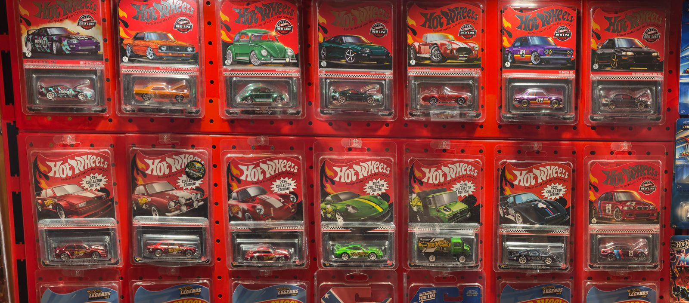
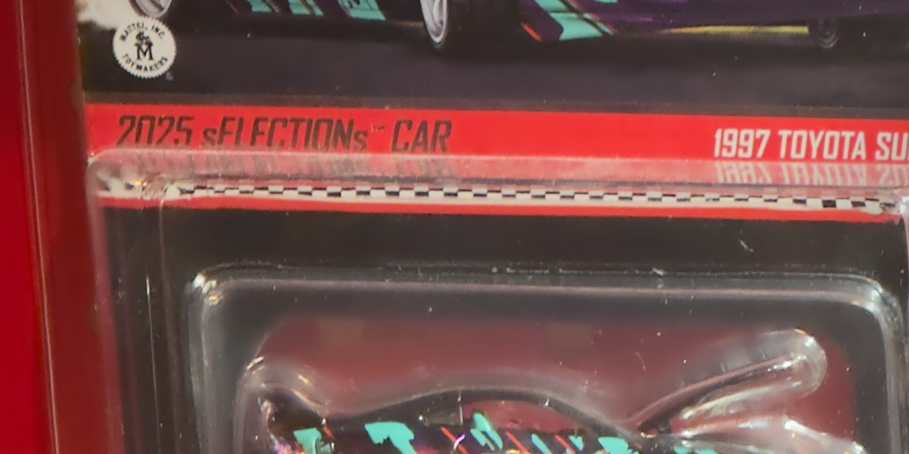

# iPhoneGigapixelPanorama

Mac-gesteuerte iPhone-Panoramen. **Der erste Meilenstein ist eine funktionierende 360°-Ansicht aus 3×-Einzelaufnahmen: genau ein Bild pro Position.** Entrauschen ist optional und wird erst später anhand echter Vergleichsaufnahmen bewertet.

## Beispielergebnis

Aufnahme vom 02.11.2026: 14 ProRAW-Einzelbilder, als Raster 7 × 2 im Serpentinenweg aufgenommen und über eine planare Homographie in nativen Pixeln zusammengesetzt. Ergebnis **13474 × 5941 Pixel (80 Megapixel)**, keine Nahtlücken, keine unbedeckten Flächen. Der mittlere Ausrichtungsfehler sank von 26,57 auf 2,26 Pixel; 26 Bildpaare wurden verwendet, 3 widersprüchliche verworfen. Rechenzeit 34 Sekunden.

Das Bild oben ist auf 1600 Pixel Breite verkleinert. Derselbe Bestand in voller Auflösung, 1:1 ohne Skalierung, Ausschnitt ab Position 305 / 978:

Das vollständige Bild liegt nicht im Repository; `Ergebnisse/` bleibt ausgeschlossen. Die beiden Bilder hier sind verkleinerte Belege, zusammen rund 400 KB.

## Vorhandener Quellcode (Stand 02.11.2026)

Der bisherige lokale Entwicklungsstand ist jetzt enthalten: **OsmoStudio** (Mac/iPhone, Gimbalsteuerung und Panorama), **SimpleSuperresolution** (Hugin-Stacking) und **FocusStack** (Fokusfusion).

**[Einrichtung, Startbefehle, Datenfluss und geprüfter Stand](docs/IMPLEMENTIERUNGSSTAND.md)**

Der importierte Aufnahmeweg verwendet die **1×-Hauptkamera mit 48-MP-ProRAW**. Zusätzlich ist ein reales **3×3-Telepanorama mit neun 12-MP-ProRAW-Aufnahmen** implementiert und geprüft. Der folgende vollständige 3×-Rundumlauf bleibt die nächste Entwicklungsstufe.

## Jetzt zuerst: ein einfacher 360°-Durchlauf

1. Die vorhandene Mac-Software und eigene iPhone-App verwenden.
2. Die echte 3×-Telekamera des iPhone 14 Pro Max nutzen und die tatsächlich gelieferten Bilder prüfen.
3. Ein überlappendes Raster für einen vollständigen Umlauf planen.
4. Jede Position anfahren, Stillstand abwarten und im regulären Ablauf genau einmal auslösen.
5. Jedes Quellbild mit Position und Winkeldaten vollständig am Mac speichern.
6. Die Bilder am Mac zu einer durchgehenden 360°-Ansicht zusammensetzen und die Schließnaht zwischen letztem und erstem Bild prüfen.

Als kleinster erster Nachweis ist zunächst ein **horizontaler 360°-Ring auf einer Höhe** vorgesehen. Das ist keine Zusage einer vollständigen 360°×180°-Kugel. Weitere Höhenreihen können danach ergänzt werden.

Schrittweite und Bildzahl werden aus tatsächlichem Bildwinkel, Geräteorientierung und ausreichender Überlappung bestimmt. Ein Bild pro Position bedeutet eine Kameraauslösung und ein primäres Quellbild; Fehlerwiederholungen werden gesondert protokolliert.

## Abnahme des ersten Meilensteins

- Die Aufnahmen stammen nachweislich von der 3×-Telekamera, nicht lediglich von einem digitalen Hauptkamera-Ausschnitt.
- Der Umlauf deckt 360° ab; auch die letzte und erste Aufnahme überlappen.
- Alle geplanten Quellbilder sind vollständig am Mac vorhanden.
- Das Panorama lässt sich ohne Abdeckungslücke rundum betrachten.
- Horizont, Bildübergänge, Doppelkonturen und Schließnaht sind geprüft; verbleibende Fehler sind dokumentiert.
- Anzahl der Bilder, Aufnahmezeit, Fotoformat und Ergebnisabmessungen sind festgehalten.

Es gibt zunächst keine feste Gigapixel-Zielgröße. Das vorhandene funktionierende Fotoformat wird verwendet; ProRAW ist keine zusätzliche Voraussetzung für diesen ersten Nachweis.

## Ausgangspunkt

Nach Angaben des Projektinhabers existiert bereits eine Lösung aus **Mac-Software und eigener iPhone-App**, die den DJI Osmo Mobile 3 steuert, die iPhone-Kamera auslöst, alle Bilder auf dem Mac speichert und dort verarbeitet. Die Winkeldaten des iPhone werden ebenfalls bereits abgefragt.

Der vorhandene Quellcode wurde vom Mac übernommen; Details und Grenzen sind im Implementierungsstand dokumentiert. Dieses Repository enthält zunächst **Konzept, Forschungsgrundlagen und einen Arbeitsplan**. Ein erfolgreicher neuer 3×-360°-Lauf wurde hier noch nicht nachgewiesen.

## Zielhardware

- iPhone 14 Pro Max mit eigener 3×-Telekamera und 12 MP
- DJI Osmo Mobile 3 mit bereits vorhandener Steuerung
- Mac für Steuerung, Bildspeicherung und Panorama-Verarbeitung

Vorhandene Autofokus- und Belichtungsfunktionen dürfen verwendet werden. Neue adaptive Fokus-, OCR-, LiDAR- oder HDR-Verfahren sind keine Voraussetzung für den ersten Durchlauf.

## Spätere Ausbaustufen

- **Textlesbarkeit:** Schilder, Etiketten und Gerätebeschriftungen bleiben das langfristige Qualitätsziel. OCR kann später Textstellen finden und gezielte Folgeaufnahmen steuern.
- **Optionales Entrauschen:** Zunächst ausgeschaltet. Einzelbilder mit späteren Zwei-/Vierer- oder anderen Wiederholungsgruppen vergleichen; Detailerhalt, Bewegung, Zeit und Datenmenge messen. Vier Bilder sind kein vorgeschriebener Standard mehr.
- **Fokus und HDR:** Bei Bedarf zusätzliche Fokus- oder Belichtungsaufnahmen für Textdetails ergänzen.
- **LiDAR:** Tiefen als Planungshilfe einsetzen und ihre Zuordnung zu Telebildern prüfen.
- **1×-Übersicht und 3×-Details:** Eine Referenzansicht kann die Zuordnung von Telebildern unterstützen.
- **Weitere iPhone-Verarbeitung:** Erst nach Vergleich mit der bestehenden Mac-Pipeline über eine Verlagerung von Rechenarbeit entscheiden.

Die Forschungsdokumente beschreiben diese späteren Möglichkeiten. Bei unterschiedlicher Priorisierung gilt der hier festgehaltene erste Meilenstein.

## Am Mac weiterarbeiten

1. Vorhandenen Mac-/iPhone-Code sichern und gezielt in das Repository übernehmen.
2. Den bisherigen Ablauf reproduzieren.
3. Den [Arbeitsplan](docs/WEITERARBEITEN.md) für den einfachen 3×-360°-Lauf abarbeiten.

Weitere Unterlagen:

- [Technisches Konzept](docs/KONZEPT.md)
- [Aufnahmesteuerung und zuverlässige Sitzungen](docs/ENTWURF_AUFNAHMESTEUERUNG.md)
- [Späterer Ausbau: Textpriorität und OCR](docs/TEXT_PRIORITAET.md)
- [Ideen von Claude](docs/IDEEN_CLAUDE.md)
- [Forschungsquellen](docs/QUELLEN.md)

## Status und Lizenz

Stand: 2. November 2026. Dokumentation und Entwurf; keine Builds oder Hardwaretests der geplanten Erweiterungen durchgeführt. Sprache, Frameworks und Protokolle des bestehenden Projekts sind hier noch nicht dokumentiert.

Eine Projektlizenz ist noch nicht festgelegt. Verlinkte Veröffentlichungen und fremder Quellcode behalten ihre jeweiligen Rechte und Lizenzen.
